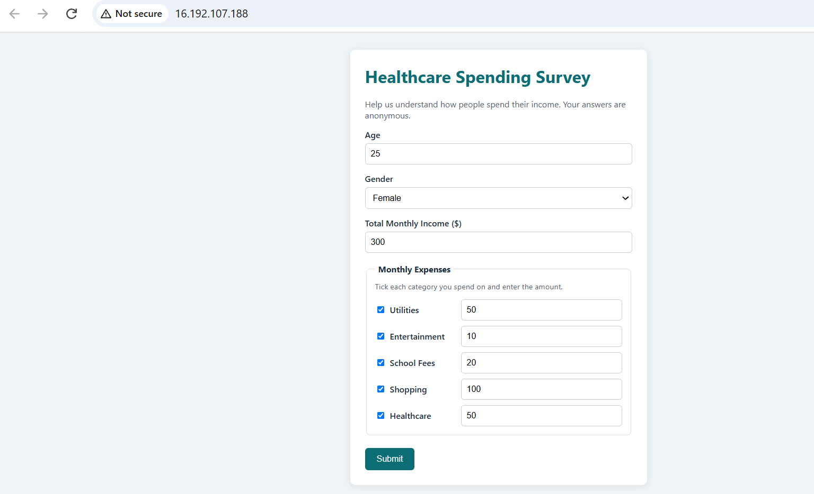
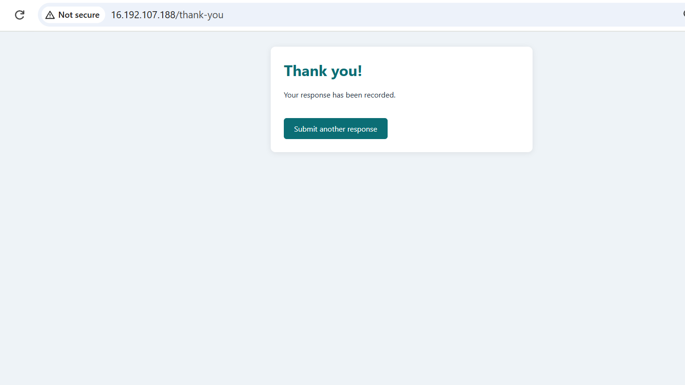
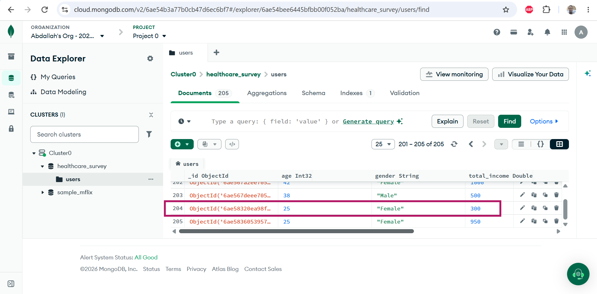
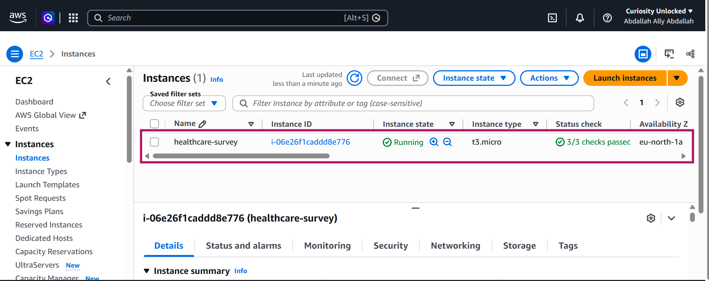

# BAN6420 Programming in R & Python Final Project: Flask Healthcare Application

For this project I built a small survey tool for a fictional data analysis company in Washington, DC that is preparing to launch a healthcare product. People fill in a web form with their age, gender, monthly income and what they spend money on. The answers are saved in online MongoDB database, exported to a CSV file through a Python `User` class, and analyzed in a Jupyter notebook. The finished app runs on AWS EC2 instance.

- **Live app:** <http://16.192.107.188/>
- **Code:** <https://github.com/abdallahdataguy/nxu/tree/main/Assignments/FinalProject>

---

## Screenshots

**The survey form running on AWS.** Each expense category has a checkbox; ticking it unlocks the amount box next to it.



**After submitting**, the user lands on a thank-you page.



**The same response saved in MongoDB Atlas** (row 204: age 25, Female, income 300), in the `healthcare_survey` database, `users` collection.



**The EC2 server** (`t3.micro`, Stockholm region) running with all status checks passed.



---

## Where each requirement is covered

| What the brief asked for | Where to find it |
|---|---|
| A Flask webpage to collect user data | [app.py](app.py), [templates/index.html](templates/index.html) |
| Store age, gender, total income and expenses in MongoDB | [app.py](app.py) saves each response with `insert_one`; the connection lives in [db.py](db.py) |
| Checkboxes for utilities, entertainment, school fees, shopping and healthcare, each with an amount box | [templates/index.html](templates/index.html), categories listed in [config.py](config.py) |
| A Python class called `User` | [user.py](user.py) |
| Loop through the data and save it to CSV | [export_to_csv.py](export_to_csv.py) → [data/user_data.csv](data/user_data.csv) |
| Load the CSV into Jupyter | [analysis.ipynb](analysis.ipynb), section 1 |
| Chart: ages with the highest income | notebook section 3 → `charts/01_*` and `charts/02_*` |
| Chart: gender distribution across spending categories | notebook section 4 → `charts/03_*` and `charts/04_*` |
| Export the charts for PowerPoint | 300-dpi PNGs in [charts/](charts/) |
| Host the app on AWS | EC2 + Gunicorn + Nginx, database on MongoDB Atlas. Full walkthrough in [AWS_DEPLOYMENT.md](AWS_DEPLOYMENT.md) |

## What's in the project

```
├── app.py                    Flask app: shows the form, checks the input, saves to MongoDB
├── config.py                 Reads settings from .env; lists the expense categories and gender options
├── db.py                     MongoDB connection
├── user.py                   The User class
├── export_to_csv.py          Loops through MongoDB and writes data/user_data.csv
├── seed_data.py              Adds random test responses so the charts have something to show
├── analysis.ipynb            Loads the CSV, cleans it, draws and exports the charts
├── templates/                HTML pages (layout, survey form, thank-you page)
├── static/style.css          Styling
├── deploy/                   systemd service and Nginx config used on the server
├── data/user_data.csv        The exported responses
├── charts/                   The four charts, ready for PowerPoint
├── screenshots/              Proof the deployed app works
├── requirements.txt          Packages the web app needs
├── requirements-analysis.txt Extra packages for the notebook (pandas, matplotlib, seaborn, Jupyter)
├── .env.example              Template for the settings file
└── AWS_DEPLOYMENT.md         How I deployed it on AWS, step by step
```

## Running it on your own computer

**You'll need** Python 3.10–3.12 (I used 3.11; on Python 3.15 some packages, PyYAML for one, don't have ready-made Windows installers yet and fail to install) and a MongoDB database. A free [MongoDB Atlas](https://www.mongodb.com/cloud/atlas/register) cluster works, and so does a local MongoDB install.

**1. Set up a virtual environment and install the packages**

```bash
python -m venv venv
venv\Scripts\activate            # Windows
source venv/bin/activate         # macOS / Linux
pip install -r requirements-analysis.txt
```

If PowerShell says running scripts is disabled, run `Set-ExecutionPolicy -Scope CurrentUser -ExecutionPolicy RemoteSigned` once and try again.

**2. Add your settings**

Copy `.env.example` to `.env` and fill in:
- `MONGO_URI`: your connection string, e.g. `mongodb://localhost:27017/` or `mongodb+srv://<user>:<password>@<cluster>.mongodb.net/`
- `FLASK_SECRET_KEY`: any long random string. `python -c "import secrets; print(secrets.token_hex(32))"` will make one for you.

You don't need to create the database in advance. MongoDB creates `healthcare_survey` the first time a response is saved.

**3. Start the app**

```bash
python app.py
```

Then open <http://127.0.0.1:5000> in your browser and fill in the form. A few things it checks: age and income are required, amounts can't be negative, and if you tick a category you have to enter an amount. Unticked categories are saved as 0.

**4. (Optional) Add test data**

A handful of responses makes for pretty empty charts, so there's a script that adds random ones:

```bash
python seed_data.py 200
```

**5. Export to CSV**

```bash
python export_to_csv.py
```

This goes through every document in MongoDB, turns each one into a `User` object and writes a row to `data/user_data.csv`. The columns are:
`age, gender, total_income, utilities, entertainment, school_fees, shopping, healthcare, total_expenses`

**6. Run the analysis**

```bash
jupyter notebook analysis.ipynb
```

Choose **Run → Run All Cells**. The charts show up in the notebook and are saved to `charts/`. To use them in PowerPoint: **Insert → Pictures → This Device**.

## The `User` class

[user.py](user.py) represents one person who filled in the survey.

- It stores `age`, `gender`, `total_income`, `expenses` (a dictionary of category → amount, with 0 for anything not ticked) and `submitted_at`.
- `total_expenses` adds up all the expenses.
- `User.from_document(doc)` builds a `User` from a MongoDB record, and `to_document()` goes the other way.
- `to_csv_row()` gives back one row for the CSV.

Both the Flask app (when saving) and the export script (when reading) go through this class, so the data has the same shape everywhere.

A saved response looks like this in MongoDB:

```json
{
  "age": 34,
  "gender": "Female",
  "total_income": 4200.0,
  "expenses": {
    "utilities": 300.0, "entertainment": 0.0, "school_fees": 0.0,
    "shopping": 0.0, "healthcare": 150.0
  },
  "submitted_at": "2026-10-30T01:05:09Z"
}
```

## What the analysis found

The analysis covers 205 responses. Full details are in section 5 of the notebook. In short:

- Income goes up with age, peaking at about **$5,410** for people aged **55–64**, then dipping slightly after 65.
- **Healthcare is the biggest spending category** (about $64,300 in total), and 74% of people reported spending on it.
- Men spent more on healthcare than women on average ($341 vs $272 per person), while women spent a bit more on shopping and school fees.
- School fees were the least common expense.

**A note on the data:** 5 of the 205 responses were entered by hand through the form: 3 while running the app locally and 2 on the live AWS site (one of them is shown in the screenshots). The other 200 were generated by `seed_data.py` so the charts would have enough data to show real patterns. The findings show how the analysis works; they don't describe a real population.

## Deployment

The app runs on an Ubuntu EC2 server in AWS's Stockholm region and the data lives in MongoDB Atlas. The Ubuntu EC2 server has a fixed Elastic IP to prevent the address from changing after restarts.

[AWS_DEPLOYMENT.md](AWS_DEPLOYMENT.md) has every step I followed, along with the problems I hit along the way and how I fixed them.
